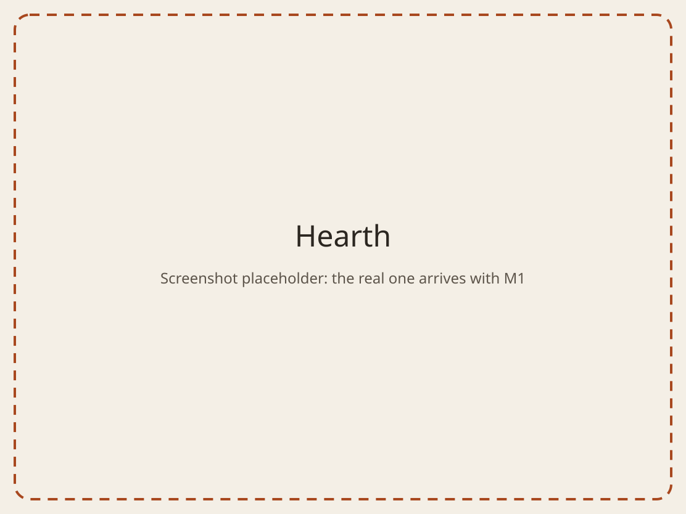

# Hearth

Hearth is a dashboard for the kitchen wall. It shows the family calendar,
the chores that are due, and who is ahead this week, on an iPad in
fullscreen Safari. It also works on phones and laptops.

It runs on a home server in Docker, on the home LAN only. There are no
accounts and no TLS: physical access to the kitchen is the trust boundary. A
PIN protects admin actions. Calendars are read only, from Google Calendar
secret-address iCal URLs that the server polls.

> **Status:** M0, the skeleton. Hearth runs and deploys, and shows the empty
> shell: header, tile grid and bottom nav. The calendar arrives in M1 and
> chores in M2. See [docs/DESIGN.md](docs/DESIGN.md) for the plan.



## Quick start (Docker)

You need git and Docker with the Compose plugin. This runs the demo with the
fictional family Ada, Linus, Marie and Grace.

```sh
git clone https://github.com/jordanjohnson56/hearth.git
cd hearth
git config core.hooksPath .githooks

mkdir -p data
export HEARTH_DATA_HOST="$PWD/data"

docker compose up -d --build
docker compose run --rm hearth npm run seed
```

Open <http://localhost:4400>, or `http://<server>:4400` from another device on
the LAN.

- `./data` is gitignored, which makes it safe for the demo. A real
  deployment points `HEARTH_DATA_HOST` at a directory outside the repository,
  such as `/srv/hearth`. See [Privacy](#privacy).
- The container runs as the unprivileged user `node`, uid 1000, gid 1000. On
  Linux, the `HEARTH_DATA_HOST` directory must be writable by uid 1000. That is
  usually your own user (check with `id -u`). If it is not, run
  `sudo chown 1000:1000 "$HEARTH_DATA_HOST"`. Create the directory before the
  first `docker compose up`. If it is missing, Docker creates it owned by root,
  and Hearth stops with `DATA_DIR must be a directory Hearth can create and
  write to: /data is not writable`.
- `HEARTH_DATA_HOST` is required. Without it, `docker compose` refuses to
  start the container and prints
  `set HEARTH_DATA_HOST to an absolute path outside the repo`. To avoid
  exporting it in every shell, put `HEARTH_DATA_HOST=/absolute/path` in a
  `.env` file next to `docker-compose.yml`. Compose reads that file, and git
  ignores it.
- The seed applies any pending migrations first, then adds the four people.
  It upserts by display name, so it is safe to run again.
- `docker compose logs -f` follows the logs (JSON lines), and
  `docker compose down` stops Hearth. The container restarts on its own unless
  you stop it.

## Configuration

Hearth reads four environment variables at startup. It checks them all and
refuses to start with a list of every problem. [.env.example](.env.example)
holds the defaults. Everything a person sets up, such as people, calendars,
the PIN and chores, lives in the database under `DATA_DIR`, not here.

| Variable | Default | Meaning |
|---|---|---|
| `PORT` | `4400` | Port the server listens on (1 to 65535). Under Docker the container always listens on 4400; to publish a different host port, change `ports` in `docker-compose.yml`. |
| `DATA_DIR` | `./data` | Directory for the SQLite database (`hearth.db`). Relative paths resolve against the working directory. Hearth creates it if it is missing, and it must be writable. Under Docker this is always `/data` inside the container; set `HEARTH_DATA_HOST` instead. |
| `TZ` | `America/Chicago` | IANA time zone name, such as `Europe/Paris`. All date math uses it: what is due today, Monday to Sunday weeks, and season boundaries. Fixed offsets such as `-06:00` are rejected. |
| `LOG_LEVEL` | `info` | One of `fatal`, `error`, `warn`, `info`, `debug`, `trace` or `silent`. |
| `HEARTH_DATA_HOST` | none, required | Docker Compose only: the absolute host directory mounted at `/data`. Keep it outside the repository. |

An empty value counts as unset and falls back to the default. Under Docker,
`TZ` and `LOG_LEVEL` come from your shell or the `.env` file next to
`docker-compose.yml`. Outside Docker, Hearth reads only the process
environment, so set the variables in your shell, for example
`TZ=Europe/Paris npm start`.

## Development

You need Node 22, which is the version in `.nvmrc` and the Docker image.
Another major version fails at runtime in `better-sqlite3`'s native module.

```sh
git config core.hooksPath .githooks   # required in every clone, see below
npm ci

npm run dev          # server (port 4400) plus Vite with hot reload; open http://localhost:5173
npm run build        # client to dist/client, server to dist/server
npm start            # run the build on http://localhost:4400
npm run seed         # seed the fictional family into DATA_DIR (runs the build; run npm run build first)
npm run seed:dev     # the same, straight from the TypeScript sources

npm run typecheck
npm run lint
npm test             # add -- --coverage for a coverage report
./scripts/privacy-check.sh   # before every push
```

`git config core.hooksPath .githooks` is a required step for every clone.
Git does not clone hooks. This setting turns on the pre-commit hook, which
scans each commit for secrets with [gitleaks](https://github.com/gitleaks/gitleaks).
The hook fails when gitleaks is not installed. Install the version that CI
pins in `.github/workflows/ci.yml` (8.30.1).

## Privacy

This repository is public, and the data Hearth handles is not. The family's
calendar URLs, names and photos must never enter git history, because a
commit cannot be taken back once it is pushed.

- Everything personal lives in the SQLite database under `DATA_DIR`, never in
  the repository or in `.env`. A secret-address iCal URL gives full read
  access to a calendar, so Hearth keeps it only in the database. It never
  logs one or sends one to the browser.
- `DATA_DIR=./data` is only the demo default for running outside Docker. `data/`
  is gitignored, so a clone that runs the demo commits nothing.
- Under Docker the database lives in `HEARTH_DATA_HOST`. Compose requires the
  variable, so a deployment can never fall back to a directory inside the
  repository. For a real household, use an absolute path outside the
  repository.
- The only names in this repository, in code, tests, seed data, screenshots
  and docs, are those of the fictional family: Ada, Linus, Marie and Grace.
- Run `./scripts/privacy-check.sh` before every push. Never commit `.env`,
  database files, `.ics` files or avatars.

## License

[MIT](LICENSE)
