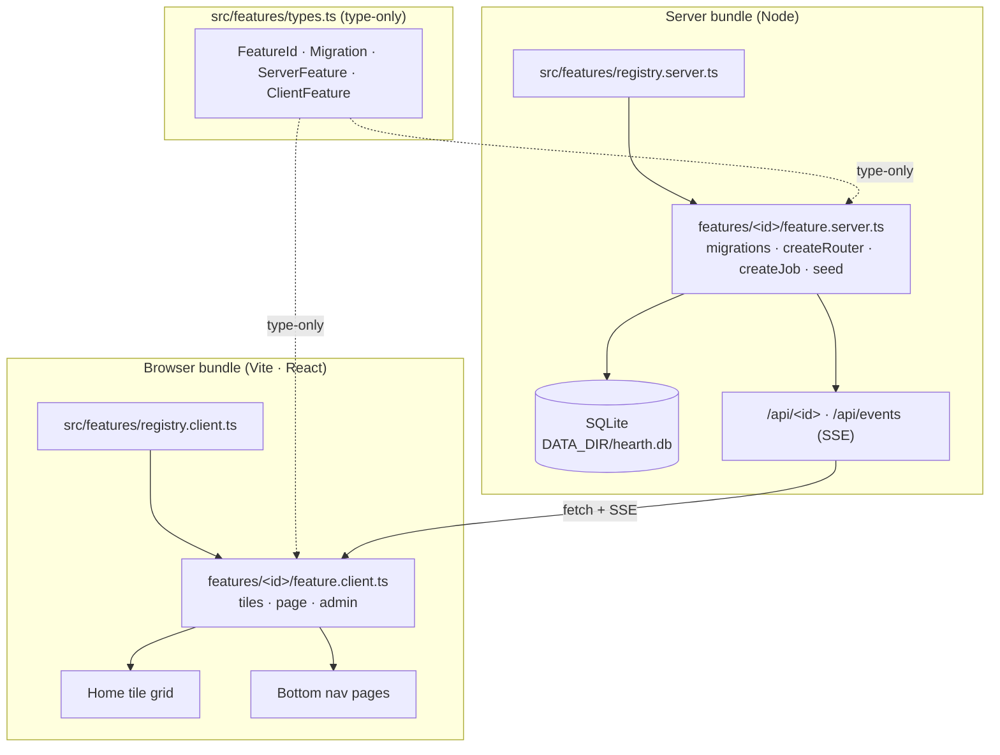

# Hearth design

Hearth is a kitchen dashboard: a shared family calendar and a gamified chore tracker. It runs on a home server and is shown on an always-on wall-mounted iPad. Its code is built from feature modules, and the repository is public.

This document is the implementation plan. The repository holds the privacy rails, the M0 skeleton, the M1 calendar and the M2 chores and scoring (section 1 lists what is where). Milestones M0–M3 (section 11) describe what to build, in order; M3 is next.

---

## Working on Hearth (read first)

This section is for whoever picks up the next milestone, human or agent.

- **Build one milestone at a time, in order.** Each milestone in section 11 has acceptance criteria. A milestone is done when every criterion is met and CI is green. Split a milestone into small PRs when that helps review, and land them in order.
- **Locked decisions are settled.** Section 2 lists them. Do not reopen them in passing. If implementation shows one is wrong, stop and raise it with a human, with the evidence.
- **Some decisions this document leaves open.** They are marked **Agent proposes, human approves**. Write the proposal in the PR description (or an ADR under `docs/adr/` when it constrains future work) and wait for approval before building on it. Items in section 13 (Open questions) need a human decision before the work that depends on them starts.
- **The privacy rails guard against the one failure that cannot be fixed later (section 3).** `.gitignore`, `.gitleaks.toml`, `.githooks/pre-commit`, `.env.example`, `scripts/privacy-check.sh` and the CI secret-scan job are reviewed by a human before any change to them merges. Never weaken a rule to get a commit through.
- **Follow the privacy procedure in section 14 in every session.** That includes cloud sessions, where the pre-commit hook is not active by default.
- **Domain vocabulary.** When a term in this document is resolved precisely during implementation, record it in `GLOSSARY.md` at the repo root (see `docs/agents/domain.md`). When an implementation decision constrains future work, record it as an ADR under `docs/adr/`.

### Standing review criteria (every milestone)

- No `any` unless a comment justifies it.
- Discriminated unions instead of objects full of optional fields.
- Errors handled at the boundary (HTTP handler, poll job, migration runner), never swallowed.
- Tests pin behavior at the edges: DST transitions, week boundaries, empty input, malformed input. The happy path alone is not enough.
- No device-specific literals in CSS (section 8).

---

## 1. Current state of the repository

After M2. The privacy rails first, then the application.

| Path | What it is |
|---|---|
| `LICENSE` | MIT. |
| `.gitignore` | Ignores `node_modules/`, `dist/`, `data/`, `coverage/`, `.env` and `.env.*` (except `.env.example`), every SQLite variant (`*.db`, `*.db-*`, `*.sqlite`, `*.sqlite3`), `*.ics` and `avatars/`. |
| `.env.example` | Bootstrap config only: `PORT=4400`, `DATA_DIR=./data`, `TZ=America/Chicago`, `LOG_LEVEL=info`. Everything a person would configure lives in the database. |
| `.gitleaks.toml` | Extends the default gitleaks rules with three project rules: Google Calendar secret-address iCal URLs, `webcal://` URLs, and inline `BEGIN:VCALENDAR` payloads. The allowlist covers `.gitleaks.toml` itself, any `DESIGN.md` (including this file) and the hand-written iCalendar fixtures in `test/fixtures/ical/*.txt` (M1, human-approved). |
| `.githooks/pre-commit` | Runs `gitleaks git --staged --redact --config .gitleaks.toml`, and fails hard when gitleaks is missing. Active only after `git config core.hooksPath .githooks`, because hooks are not cloned. |
| `scripts/privacy-check.sh` | The three checks to run before a push (section 14). |
| `.github/workflows/ci.yml` | **Secret scan** job: gitleaks over the full history (`fetch-depth: 0`) and over the working tree. **Build** job: `npm ci`, `npm run typecheck`, `npm run lint`, `npm test -- --coverage`. **Docker image** job: builds the real Dockerfile and smoke-tests the container as uid 1000 (boots, migrates, serves `/`, exits 0 on SIGTERM). |
| `.nvmrc` | `22`, to match the Docker base image. A different host Node version would surface only at runtime, as a native-module ABI crash in `better-sqlite3`. |
| `README.md` | What Hearth is, the Docker quick start, the configuration table, admin (PIN, people, theme times), calendar setup (secret addresses, the status row), chores (rule kinds, waiting and overdue, the claim flow, the board, corrections), development commands and the privacy note. |
| `package.json`, `tsconfig*.json`, `eslint.config.js`, `vite.config.ts`, `vitest.config.ts` | Node 22, TypeScript strict with `noUncheckedIndexedAccess`, `exactOptionalPropertyTypes` and `verbatimModuleSyntax`; three tsconfig projects (server, client, node); ESLint `strictTypeChecked` with the layering rules of section 4; Vitest with `TZ=UTC` forced. |
| `Dockerfile`, `docker-compose.yml` | Multi-stage build on `node:22-bookworm-slim`, runtime as the unprivileged `node` user with only `/data` writable; Compose requires `HEARTH_DATA_HOST` and bind-mounts it at `/data` (M0). |
| `src/server/` | Express app factory (`app.ts`), config loader, pino logger with URL redaction, SSE change hints (`events.ts`, `broadcaster.ts`), the migration runner and repositories under `db/`, the seed entrypoint (the fictional family, then each feature's `seed`) and `main.ts`, the only reader of `process.env`. |
| `src/server/admin.ts` | Core admin: the 4-digit PIN (scrypt, `pinHash.ts`), in-memory unlock tokens (10 minutes sliding, 60 minutes absolute), the lockout after 5 failures and the `requireAdmin` gate handed to features through the context (M1). |
| `src/server/settings.ts` | `/api/settings`: the theme times `theme.light_from` and `theme.dark_from` as `HH:MM` (M1). |
| `src/server/people.ts` | `/api/people`: `GET` is public; `POST` (add) and `PATCH /:id` (rename, recolor) need the bearer. Display names are unique ignoring case. No change hint: the chores board embeds the people it shows (M2). |
| `src/server/scheduler.ts` | Runs each feature's poll job once after the server listens, then on its interval, with an overlap guard per job (M1). |
| `src/core/` | The pure core (section 4): zone-aware date math over the Temporal polyfill (`time.ts`), the polyfill-free `localDateText.ts`, `clock.ts`, `theme.ts` (switch evaluation), `personColor.ts`, `changeHint.ts`. |
| `src/features/` | `types.ts` (the feature contract, type-only), the server and client registries, `calendar/` and `chores/`. |
| `src/features/calendar/` | The M1 feature: `SecretUrl`, the bounded fetcher, the ical.js provider with recurrence expansion (`provider.ts`, the only ical.js importer), source and event repositories, the service with its change digest, `feature.server.ts` (migration `calendar#1`, `/api/calendar`, the 10-minute poll job), the admin panel, the Day at a glance tile and the month page. |
| `src/features/chores/` | The M2 feature: the rule kinds and due-date expansion (`rule.ts`, `dueDates.ts`, ADR 0005), the pool (`pool.ts`: waiting, overdue, due today) and the weekly standings (`standings.ts`), the chore and the insert-only completion repositories, the board and corrections services, `feature.server.ts` (migration `chores#1`, `/api/chores`, the demo chores in `seed.ts`), the Chores today and Leaderboard tiles, the Chores page, the shared claim flow (person picker, undo toast) and the admin panel (definitions, the 14-day completion list with Void and Reassign). |
| `src/client/` | The React shell: header clock, bottom nav, tile grid with ghost slots (wide tiles lead), the router, live updates over SSE with a 5-minute backstop, `useFeatureData`, the theme hook, `PersonAvatar` (the colored initial) and the stylesheet tokens under `styles/`. |
| `src/client/admin/` | The `/admin` route: "Set a PIN", the PIN pad, the unlocked core panel (people with the palette picker, change PIN, theme times, lock now) and each feature's admin panel below it (M1, people M2). |
| `test/` | Cross-cutting tests (DST and zone injection, the client-bundle guard against the polyfill, the ical.js import boundary, palette contrast) and helpers (including `featureHarness`, an app with the PIN set and unlocked and an injected clock); `test/fixtures/ical/` holds the fictional iCalendar fixtures as `.txt` (section 14). |
| `docs/adr/` | ADRs: 0001 Temporal polyfill, 0002 epoch-millisecond instants in SQLite, 0003 ical.js, 0004 epoch milliseconds on the wire, 0005 chores rule kinds. |
| `GLOSSARY.md` | The project vocabulary (see `docs/agents/domain.md`). |
| `docs/mockups/home-layout.html` | Accepted navigation reference: three views (Home, Calendar, Chores), a tile-grid landing view, and a full-bleed month calendar. Its caption lists what later decisions superseded; section 8 is authoritative where they differ. Its device frame is 1180×820, but the reference viewport is 1112×834 (section 8). |
| `docs/agents/` | Conventions for the agent skills: issue tracker (GitHub Issues), triage labels, domain docs. |
| `.claude/skills/`, `.agents/skills/` | Agent skills (see `skills-lock.json`). |

Seasons, bonuses, avatar upload and the kiosk layer (M3) do not exist yet.

---

## 2. Purpose, non-goals and locked decisions

### Purpose

A dashboard that hangs in the kitchen and answers three questions at a glance: what is happening today, what chores are waiting, and who is ahead this week. It must be publicly readable as source code, while the family's calendar, the children's names and their photos never enter git history.

### Non-goals

- Internet exposure, TLS, or user accounts.
- Writing back to calendars. Calendar access is read-only by construction.
- Multi-household or multi-tenant use.
- Native apps. The client is a web app in fullscreen Safari.

### Locked decisions

- **Runtime:** Node 22 and Express, in Docker, on the home LAN, with no public exposure. Port 4400.
- **Primary device:** iPad Air 3 in fullscreen Safari / Add to Home Screen. It must also work on phones and laptops (section 8).
- **Calendar:** Google Calendar secret-address iCal URLs, polled server-side behind a `CalendarProvider` interface. Read-only.
- **People:** named, each with a color and an avatar. No login for daily use; physical access to the kitchen is the documented auth boundary. A 4-digit PIN gates admin actions.
- **Claim flow:** tap a chore, tap an avatar, then a ~10 s undo toast. Later corrections need the PIN.
- **Scoring:** a weekly Monday–Sunday leaderboard, plus configurable seasons with a real-world reward.
- **Storage:** SQLite via `better-sqlite3`, with numbered SQL migrations applied at boot. Repository modules mean domain logic never sees SQL.
- **Client:** React + Vite + TypeScript in strict mode. Bottom nav (Home / Calendar / Chores). The home tile grid is the landing view.
- **Theme:** light by day, dark by night, switching at configurable fixed times.
- **Live updates:** SSE at `GET /api/events`, broadcasting which feature changed, with a 5-minute polling backstop.
- **Tests:** Vitest on the pure core. Supertest against a throwaway SQLite file per test.
- **Packaging:** multi-stage Dockerfile, plus docker-compose with `restart: unless-stopped`.
- **License:** MIT.

---

## 3. Threat model and privacy posture

- **Trust boundary:** the physical kitchen and the home LAN. No inbound ports are opened, and there is no TLS and there are no accounts.
- **The PIN** protects against a child, not an attacker.
- **The one real secret is the iCal URLs.** A secret-address URL is a bearer credential to an entire calendar. These URLs live only in SQLite under `DATA_DIR`, which is outside the repo tree. They must never appear in a log line, an error message, an API response or a client bundle. Log a source by its label or id, never by its URL.
- **The permanent, unfixable risk** is committing children's names, photos or the family schedule to public git history. Git history is permanent, and a leak has no remediation. Every other risk in this project can be fixed after the fact; this one cannot.
- **Fictional data only.** Every name in code, tests, fixtures, seed data, screenshots and docs comes from the fictional family **Ada, Linus, Marie, Grace**. None of these names may belong to a real household member. That is what makes the history name-grep (section 14) meaningful.
- **Documented examples must be obviously fake**, e.g. `https://calendar.google.com/calendar/ical/EXAMPLE/private-EXAMPLE0000000000/basic.ics`.
- **`DATA_DIR`:** `./data` is the bare-metal demo default. It is gitignored, so a stranger's clone runs without leaking anything. The real deployment runs under Docker with the container's `DATA_DIR=/data` bind-mounted from `${HEARTH_DATA_HOST}`, an absolute host path outside the repo (section 11, M0).

---

## 4. Architecture

### Feature contract

Each feature (Calendar, Chores, future ones) is one folder under `src/features/<id>/`. That folder has a server half and a client half, so Express and `better-sqlite3` never end up in the Vite browser bundle. The two halves share one type-only module.



```ts
// src/features/types.ts: type declarations only. Every import is `import type`.
import type { Database } from 'better-sqlite3';
import type { RequestHandler, Router } from 'express';
import type { Logger } from 'pino';
import type { FC } from 'react';
import type { Broadcaster } from '../server/broadcaster.js';
import type { Config } from '../server/config.js';

export type FeatureId = 'calendar' | 'chores';

export interface Migration { id: number; name: string; sql: string }

export interface FeatureContext {               // handed to the factories below
  db: Database; broadcaster: Broadcaster; logger: Logger; config: Config;
  now: () => Date;                                // injected so tests drive time
  fetch: typeof globalThis.fetch;                 // injected so tests drive the network
  requireAdmin: RequestHandler;                   // core's bearer-token gate
}

export interface FeatureJob { name: string; intervalMs: number; run(): Promise<void> }

export interface ServerFeature {
  id: FeatureId;
  name: string;
  migrations: readonly Migration[];               // owns its own tables
  createRouter?(ctx: FeatureContext): Router;     // mounted at /api/<id>
  createJob?(ctx: FeatureContext): FeatureJob;    // run by the scheduler
  seed?(db: Database, now: Date, zone: string): string[]; // fictional demo data, idempotent
}

export interface ClientFeature {
  id: FeatureId;
  name: string;
  tiles?: readonly { component: FC; size: 'sm' | 'wide' }[]; // Home tiles, wide ones lead
  page?: { component: FC; icon: string };
  admin?: { component: FC };                      // panel under the core /admin panel
}
```

```ts
// src/features/registry.server.ts (registry.client.ts mirrors it with ClientFeature)
export const serverFeatures = {
  calendar: calendarServer,
  chores: choresServer,
} satisfies { [K in FeatureId]: ServerFeature & { id: K } };
```

Server and client are kept in sync at compile time. Both registries must cover every `FeatureId` exactly once, and each key must match its feature's `id`. A feature missing from either side, or registered under the wrong key, is a type error. Do **not** add a runtime cross-check: the server cannot import the client registry without pulling React into the server.

Adding a feature takes one folder, one `FeatureId` member and one line in each registry.

**The type-only boundary is enforced by tooling, not by review.** A single value import in `types.ts` would silently pull Express or React into the wrong bundle. M0 enables `verbatimModuleSyntax` in tsconfig and an ESLint rule that rejects value imports in `src/features/types.ts` (`@typescript-eslint/consistent-type-imports`, plus `no-restricted-imports` scoped to that file if needed). The server's tsconfig must resolve `@types/react` so `ClientFeature` type-checks there.

### Core vs features

People, settings (theme times, PIN hash, seasons), the admin shell and the migration runner are **core**, not features. Features may reference core tables. Features never reference each other's tables or import each other's modules.

### Layering (server)

```
HTTP router / poll job      ← validates input, handles errors, maps to HTTP
  └─ service functions      ← orchestrates: load via repositories, call pure core, persist
       ├─ repositories      ← the only code that contains SQL
       └─ pure core         ← no I/O, no database, no clock, no process.env
```

### Pure core

The pure core is the main test target. It contains:

- recurrence expansion;
- due-today and overdue detection;
- weekly and season aggregation;
- bonus evaluation (M3);
- ICS parsing and normalization.

Conventions:

- **Data in, data out.** No database, no network, no filesystem.
- **Time is a parameter.** Every function that depends on the current time takes `now: Date` (an instant) **and** `zone: string` (an IANA zone such as `America/Chicago`). The core never reads `process.env.TZ` and never relies on the process's local time. The zone comes from config at the boundary. As a result, tests cover Chicago DST transitions identically on a CI runner in UTC. Use a zone-aware library for local-date math (agent proposes which one in M0, human approves).
- **Comments only for non-evident constraints**, e.g. `// Week starts Monday`, `// Today isn't over yet, so an incomplete today does not break the streak`.

### Migrations

- The core migration set runs first, then each feature's set in registry order. Each set is numbered from 1 independently.
- Applied migrations are tracked in a core table keyed by `(scope, id)`, where `scope` is `'core'` or a `FeatureId`. A plain numeric id would collide across features.
- Each migration runs in a transaction together with its tracking row. A failure rolls back and aborts boot.
- Re-running the runner on an up-to-date database is a no-op.
- Applied migrations are never edited. Fix forward with a new migration.

### Data flow

1. Poll jobs (calendar) and API writes (chores) change SQLite.
2. The server broadcasts a change hint on `GET /api/events`: just the `FeatureId`, no data.
3. Clients refetch that feature's data from `/api/<id>`.
4. Clients also refetch everything every 5 minutes, as a backstop for dropped SSE connections. iPad Safari drops them when the screen sleeps.

---

## 5. Data model

**Agent proposes the DDL in M0 (core) and in M1/M2 (features); a human approves it.** The entities and invariants below are decided.

Conventions:

- Instants are stored as UTC (epoch milliseconds or ISO-8601 with `Z`; pick one and use it everywhere).
- Local dates are derived in the pure core from an instant plus the configured zone. They are never stored as the source of truth.

### Core

- **person:** id, display name (fictional in all committed data), color, optional avatar path (the file lives under `DATA_DIR`).
- **setting:** key/value. Holds theme switch times, the PIN hash, the calendar zone and similar values.
- **season:** id, name, start date, end date (inclusive local dates), reward text.
- **migration tracking:** `(scope, id)` primary key, name, applied-at.

### Calendar feature

- **calendar_source:** id, label, color, iCal URL (**secret**, see section 3), last successful fetch, last error (an error message must not contain the URL).
- **Normalized events.** Recommended: cache them in SQLite, so the dashboard survives a restart and a Google outage with the last good data. Agent proposes in M1.

### Chores feature

- **chore:** id, name (unique ignoring case), recurrence rule (JSON text, ADR 0005), point value, start date (a local date), archived-at instant, created-at. Chores are archived, never deleted, because completions reference them.
- **completion:** id, chore id, person id, completed-at instant, **points awarded** (copied from the chore at claim time, so later edits to a chore's points never rewrite past weeks or seasons).
- **completion_void:** completion id (unique), voided-at instant, reason (`undo` or `correction`).

**The completion log is append-only.** Repository code never issues `UPDATE` or `DELETE` against `completion`. The ~10 s undo and every PIN-gated correction insert a `completion_void` row. Every query that counts or displays completions excludes voided ones. Weeks and seasons are only queries over this log; nothing is ever reset.

---

## 6. API surface

- `/api/<featureId>/…`: each feature's router. Agent proposes the routes per milestone.
- `GET /api/events`: SSE that emits `{ "feature": "<FeatureId>" }` change hints.
- `/api/people` (core, M2): `GET` public, `POST` and `PATCH /:id` behind the admin bearer. A person edit publishes no hint.
- `/api/settings` (core, M1): the theme times.
- Admin mutations (people, calendar sources, chores, seasons, theme times, PIN) require PIN verification. **Agent proposes** the unlock mechanism (e.g. a short-lived admin token issued after PIN verification), and a human approves it.
- No response ever includes an iCal URL. Admin views of a source show its label and a masked hint only.
- Request bodies are validated at the router. Invalid input returns a 4xx with a message, never a stack trace.

---

## 7. Frontend structure and navigation

- **Bottom nav:** Home, Calendar, Chores.
- **Header:** time and date at equal size, plus an admin (PIN) button.
- **Home tile grid** (landing view):
  - **Chores today** (wide): the unclaimed pool, overdue first, then highest points. It is capped, with a `+N more` link to the Chores page. A completed chore drops off.
  - **Leaderboard:** relative standings for the current Monday–Sunday week.
  - **Day at a glance:** all of today, including what has already happened. It scrolls.
  - **Ghost slots** for future features (dashed placeholders).
- **Calendar page:** full month grid, color-coded per source.
- **Chores page:** Waiting (the full pool), Anytime, Upcoming (each with its next due date) and Recent (this week's completions). Because chores are an unassigned shared pool, there are no per-person attributions or rotations, and the mockup's per-person tabs and Tomorrow column are dropped; this supersedes the mockup.

---

## 8. Responsive layout and the kiosk layer

**1112×834 (iPad Air 3, landscape) is the reference viewport, not a target.** Verify it first, but nothing in the CSS may encode it. Other people will open the app on phones and laptops.

Each of these fails review:

- Fixed pixel widths or heights on layout containers. Any `1112`, `834` or `min-width: 1112px` literal.
- Media queries keyed to a device instead of the width where *this* layout breaks. Find breakpoints by resizing until the tile grid looks wrong.
- A tile grid that assumes a column count. Use `grid-template-columns: repeat(auto-fill, minmax(<min>, 1fr))`, and map `size: 'sm' | 'wide'` to `grid-column: span N`, clamped so `wide` falls back to full width on narrow screens instead of overflowing.
- Assuming landscape. Portrait must work; the nav and grid reflow rather than letterbox.
- `100vh` for full-height regions. Use `100dvh`.
- Hard-coded `px` font sizes. Prefer `rem` or `clamp()`.

Touch targets stay ≥ 44 px. That is a rule for a class of device, and it is fine to encode.

**Kiosk layer.** Behavior that genuinely only matters on the iPad belongs in the PWA/meta layer, not in layout CSS: `viewport-fit=cover` with `env(safe-area-inset-*)`, `apple-mobile-web-app-capable`, and disabling text-size adjustment. Keep that boundary explicit.

---

## 9. Theming

- Light by day, dark by night.
- The switch times are two configurable fixed times (light-from, dark-from) stored in settings as `HH:MM`, defaulting to 07:00 and 19:30. They are evaluated in the configured zone, not the device's. At exactly light-from the theme is light; at exactly dark-from it is dark; either order works, so a dark period (or a light one) may wrap midnight. A switch minute that a DST gap skips takes effect at the first wall minute after the gap.
- The client evaluates every minute on the wall clock with `Intl` parts (`src/core/theme.ts`) and sets `data-theme` on `<html>`; the device's own light/dark setting is only a fallback before the client runs. The times are fetched at load and on the 5-minute backstop, so an admin edit applies at once on the editing device and reaches the wall within five minutes. There is no manual toggle.
- The theme is defined as CSS custom properties with one set per theme. Components never hard-code colors.
- Each person's color must stay legible in both themes.

---

## 10. Scoring rules

- A completion earns its snapshotted `points awarded`. Voided completions earn nothing.
- **Week:** Monday 00:00 to the following Monday 00:00 in the configured zone. A DST week is 167 or 169 hours long, and that is correct.
- **Leaderboard:** standings by points for the current week.
- **Season:** the sum over its inclusive local-date range. The person with the most points at season end earns the reward.
- **Bonuses (M3):** blocked on a human-written bonus rule spec (section 13). Bonus evaluation will be pure and use the same log.

---

## 11. Milestones

### M0: Skeleton

Build:
- `package.json` with `typecheck`, `lint`, `test`, `dev`, `build`, `seed`.
- tsconfig: `strict`, `noUncheckedIndexedAccess`, `exactOptionalPropertyTypes` and `verbatimModuleSyntax`. Keep all four unless one hits a concrete blocker; if it does, record the reason in an ADR.
- ESLint, including the type-only rule for `src/features/types.ts`.
- Vitest and Supertest.
- Bootstrap config loader: validates `PORT`, `DATA_DIR`, `TZ` and `LOG_LEVEL` at startup, and fails fast with a clear message.
- Express server that serves the Vite build; feature registries, empty but typed; the migration runner with the core migrations; `GET /api/events`.
- React shell: bottom nav, header and an empty tile grid with ghost slots.
- A zone-aware date utility in the pure core (week start, local date of an instant).
- Multi-stage `Dockerfile` on `node:22-bookworm-slim`, with `python3`, `make` and `g++` in the builder stage for `better-sqlite3`. Do not use Alpine: prebuilt binaries don't match musl, and the failure only appears at runtime.
- `docker-compose.yml` with `restart: unless-stopped`. It sets the container's `DATA_DIR=/data` and bind-mounts `${HEARTH_DATA_HOST:?set HEARTH_DATA_HOST to an absolute path outside the repo}:/data`. The variable is required, so a real deployment can never silently write inside the repo tree.
- Seed script that creates the fictional family. It runs **inside the container** against `/data` (`docker compose run --rm <service> npm run seed`), so seeded data and the running app always use the same directory.
- `README.md`: what Hearth is; quick start; a configuration table; development commands; `git config core.hooksPath .githooks` as a required step for every clone; a privacy note on `DATA_DIR` and `HEARTH_DATA_HOST`. The demo quick start sets `HEARTH_DATA_HOST` to an absolute path of the gitignored `./data`. Use a screenshot placeholder until M1.

Acceptance:
- `npm run typecheck`, `npm run lint` and `npm test` pass locally, and the CI build job (now active) is green.
- Migration runner tests: a fresh database applies everything; a second run is a no-op; a failing migration rolls back and leaves no tracking row; core runs before features; `(scope, id)` collisions across scopes are allowed.
- A value import added to `src/features/types.ts` fails lint (verify once, don't commit it).
- With `TZ=UTC` in the process environment, date-utility tests compute the correct `America/Chicago` week start and local date across both 2026 DST transitions (March 8 and November 1).
- `docker compose up` serves the shell on port 4400, and the container fails to start when `HEARTH_DATA_HOST` is unset.

### M1: Calendar (goes on the wall)

Status: built on PR #24 (spec #14, tickets #15 to #23); the functional verification record is in that PR's description.

Build:
- The `CalendarProvider` interface and an iCal implementation.
- A poll job.
- Calendar source management in admin (PIN-gated, including the unlock mechanism from section 6).
- The month-grid Calendar page.
- The Day at a glance tile.
- The theme switch (section 9).

Acceptance:
- ICS parsing tests: all-day events, recurring events (RRULE), `EXDATE`, `DTSTART` with a TZID, in UTC and floating, and events crossing DST.
- `CalendarProvider` exposes normalized events only; no iCal types leak past it.
- A failed poll keeps the last good data and surfaces staleness. It never blanks the calendar.
- Tests show an iCal URL cannot reach a log line, an error message or any API response.
- Layout checks (section 8) at the reference viewport and from ~360 px to ~1920 px, in portrait and landscape.

### M2: Chores and scoring

Status: built on PR #35 (spec #26, tickets #27 to #33); the functional verification record is in that PR's description.

Build:
- Chore definitions, managed in admin.
- The Chores today tile, the claim flow with the undo toast, and PIN-gated corrections.
- The Leaderboard tile and the Chores page.
- Avatars may fall back to a colored initial until M3.

Acceptance:
- Recurrence expansion and due/overdue detection tested across DST and week boundaries in `America/Chicago`.
- The append-only invariant holds: no `UPDATE` or `DELETE` on `completion` anywhere in repository code. Undo and corrections produce void rows, and every aggregate excludes voided completions.
- Changing a chore's point value does not change past weekly totals.
- Scoring functions are pure and fully covered.

### M3: Seasons, bonuses, polish

Build:
- Season management and the season standings/reward display.
- Bonus rules, once the spec exists.
- Avatar upload, stored under `DATA_DIR` and never in the repo.
- The PWA/meta kiosk layer.
- The README screenshot from seeded fictional data.

Acceptance:
- Season boundaries are tested with inclusive local dates.
- Bonus evaluation is pure and tested against the spec.
- Uploaded avatars land under `DATA_DIR`, and `scripts/privacy-check.sh` stays clean.

---

## 12. Deferred

- Onboarding wizard.
- Week and Day calendar views.
- Playwright end-to-end tests.
- A Google OAuth `CalendarProvider`.

---

## 13. Open questions (human decision required)

- **Bonus rule spec.** What earns a bonus, how much, and how it interacts with seasons. Blocks the bonus part of M3.
- **Recurrence rule format for chores.** Decided in the M2 grilling session (ADR 0005): Hearth's own rule kinds (`daily`, `weekly` on weekdays, `every` N days or weeks from the start date, `monthly` on a clamped day, `whenever`), stored as JSON text and expanded over local dates in the pure core. Not RRULE.
- **Overdue stacking.** Decided in the M2 grilling session: one item per chore. A chore is waiting when it has a due date on or before today later than its last unvoided completion (or its start date); it is overdue when the earliest such date is before today, shown as days late. One claim satisfies every due date up to today; missed due dates earn nothing.
- **Admin unlock lifetime and PIN attempt limits.** Decided in spec #14 (M1): a token lives 10 minutes from its last use and 60 minutes from issue, in memory only; after 5 consecutive failures unlock refuses for 30 s, doubling per failure to a 15-minute cap, process-wide, reset by a success.
- **Admin ownership.** Decided in spec #14 (M1): the core shell owns `/admin`, the PIN pad and the core panel; each feature contributes its own panel through `ClientFeature.admin`, rendered below it in registry order.

---

## 14. Privacy procedure

### Every session, before the first commit

Agents in cloud containers must do this too. The hook is not cloned, and gitleaks is usually not installed.

1. Install gitleaks at the version CI pins in `.github/workflows/ci.yml` (currently 8.30.1).
2. `git config core.hooksPath .githooks`
3. If gitleaks cannot be installed, **stop and say so**. Do not commit without the scan.

### Before every push

`./scripts/privacy-check.sh` must pass. It checks:

1. No secret-bearing file types are tracked. This is an anchored match on `.env*`, SQLite files, `.ics`, and `avatars/`, `photos/` and `uploads/` directories; `.env.example` is the one exception.
2. Working-tree scan: `gitleaks dir --config .gitleaks.toml`.
3. Full-history scan: `gitleaks git --config .gitleaks.toml`.

### Human-only: the real-name history grep

A maintainer separately greps the full history for each real family member's first name, run ad hoc from their shell:

```sh
git log -p --all | grep -in '<real-first-name>'
```

This check is never committed, never automated, and real names never appear in any file in this repository. A committed check that names the family defeats its own purpose. Agents cannot run this check, and must not ask for the names.

### Functional verification (M1 onward)

- `docker compose up` on the home server; load `http://<host>:4400` in iPad Safari and check the reference viewport, then resize in desktop devtools from ~360 px to ~1920 px in both orientations. Nothing may clip, overflow horizontally or collapse.
- `npm test` green locally and in Actions, with coverage reported on the pure core.
- Clone the public repo into a scratch directory as a stranger would, seed it per the README, run `docker compose up`, and confirm a working dashboard populated entirely by the fictional family and, from M2, the demo chores.
